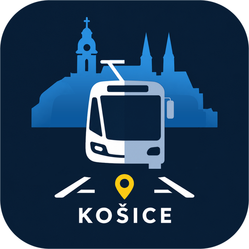

# DPMK Košice for Home Assistant

[](https://hacs.xyz/docs/faq/custom_repositories)

Pick a bus or tram stop in Košice and see **which line arrives when**, with **live delays**, plus a small **map of the vehicles around your stop**. Everything is shown on two Lovelace cards that come with the integration.

Slovak and English. The cards are Slovak by default, also when Home Assistant itself is English.

> Unofficial. Not affiliated with DPMK, a.s. It reads DPMK's public website, which could change without notice.

## What you get

- **Departures card** (`custom:dpmk-departures-card`): line badge in DPMK's official colors (square = bus, circle = tram), destination, the official timetable time and, in brackets, the real time from the live data, plus a countdown and the delay.
- **Map card** (`custom:dpmk-map-card`): a simple, non-interactive picture. A plain gray street map with your stop in the middle and the buses and trams around it. A green ring means the vehicle is arriving at your stop, red means it is leaving, and the label shows the live minutes to your stop.
- **Sensor** `sensor.<stop>_next_departure` (timestamp of the next departure) whose attributes hold the whole departure and vehicle lists, for your own templates and automations.
- No account, no API key, no extra Python packages.

## Install with HACS (custom repository)

1. In Home Assistant open **HACS**, then the ⋮ menu (top right), then **Custom repositories**.
2. Enter this repository's URL, choose the type **Integration**, and click **Add**.
3. Search for **DPMK Košice** in HACS, click **Download**, and **restart Home Assistant**.
4. Go to **Settings → Devices & services → Add integration → DPMK Košice**.

### Manual install

Copy the folder `custom_components/dpmk` into your Home Assistant `config/custom_components/` folder (so that `config/custom_components/dpmk/manifest.json` exists) and restart Home Assistant.

Needs Home Assistant 2024.7 or newer.

## Set up a stop

1. Add the integration and type the **start of a stop name**, for example `Hlavn` or `Aupark`. The search matches the beginning of a word, as on dpmk.sk.
2. Choose the stop from the list. Repeat for every stop you want (one entry per stop).
3. Open **Configure** on the integration and **place the stop on the map and set the radius**. DPMK does not publish stop coordinates, so this one step is manual. Until you do it, the stop sits at your Home Assistant home location.

## Cards

The cards are registered automatically. Add them from the card picker (**DPMK odchody**, **DPMK mapa**) or in YAML. `entity` is the sensor of your stop.

### Departures

```yaml
type: custom:dpmk-departures-card
entity: sensor.hlavna_posta_stare_mesto_next_departure
title: Hlavná pošta   # optional, defaults to the stop name
max_rows: 6           # optional, 1-20
show_delay: true      # optional
language: sk          # optional: sk (default) | en | auto (follow Home Assistant)
```

```
[35]  Exnárova                      ● 09:54 [09:55]
      o 6 min · +1 min
```

The main time is the official timetable time. The bracket is the real time (timetable plus the live delay) and appears only for trips that have live data (green dot). Rows without a dot are timetable only, because that vehicle has not started its trip yet.

### Map

```yaml
type: custom:dpmk-map-card
entity: sensor.hlavna_posta_stare_mesto_next_departure
title: Vozidlá pri zastávke   # optional
show_legend: true             # optional
background: map               # map (default) | none  (none = plain radar view)
map_style: auto               # auto (follows the theme) | light | dark
show_rings: false             # draw distance rings over the map
language: sk                  # sk (default) | en | auto
```

- The picture covers the radius you set in the integration options.
- Vehicle labels show the live minutes to your stop. A vehicle with no matching departure (for example one that already passed) shows its distance instead.
- Movement (green/red ring) is worked out from two readings, so a new vehicle starts white for one refresh.

## Options

Open **Settings → Devices & services → DPMK Košice → Configure**.

| Option | Meaning | Default |
|---|---|---|
| Lines/directions | Limit the stop to the lines and directions you care about (empty = all) | all |
| Update interval | How often the live feed is read, **5 to 120 s** | 10 s |
| Vehicles shown on the map | Only vehicles serving this stop (line **and** direction), or all vehicles in range (others dimmed, no ring or label) | serving |
| Stop location and radius | Where the stop is and how far around it the map reaches | home, 1500 m |
| Number of departures | Rows kept in the sensor attribute, 1 to 20 | 8 |
| Timetable variant on weekdays | DPMK has school-year and school-holiday timetables. `auto` treats July, August and 23 Dec to 6 Jan as holidays. Use `school` or `holidays` for other breaks (autumn, winter, spring) | auto |

Weekends and Slovak public holidays always use the "free days" timetable.

## How it works

- **Timetables** come from the current timetable pages of dpmk.sk (cached for 12 hours). On start-up the integration fetches a few extra pages per line, so it can tell where each trip starts. Trips that start partway along a line are handled as well.
- **Live data** comes from the feed behind DPMK's own map page, `https://www.dpmk.sk/api/cp/map` (position, delay, direction and start time of every running vehicle). A vehicle is matched to a timetable trip by its line, direction and start time, so the delay is applied to the right departure. The real time assumes the vehicle's current delay stays the same until your stop.
- **Request rate**: all stops share one cached read of the live feed. It is never requested more often than every **5 seconds**, whatever you configure. Timetables are requested only at start-up and then every 12 hours.
- **Line colors** are read from DPMK's stylesheet, so they follow DPMK's own palette. Lines that DPMK leaves uncolored are shown gray.
- **Map tiles** are Esri's gray base maps (© Esri, HERE, Garmin, © OpenStreetMap contributors). They need no key. Your browser loads them directly, so Esri can see the map area and your IP address, like with any web map. Use `background: none` to avoid that.

## Good to know

- DPMK refreshes a vehicle's position only about every **20 seconds** (sometimes up to a minute), and vehicles occasionally drop out of the feed for a while when their GPS signal is lost. A bus that is close to your stop can therefore appear late. Update intervals below 10 s rarely help.
- The feed has no destination or heading. Arriving or leaving is guessed from whether a vehicle gets closer to or farther from your stop between readings, using straight-line distance.
- Only DPMK Košice city lines are covered.

## Troubleshooting

**"Custom element doesn't exist: dpmk-departures-card" (or the map card)**
1. Open `http://YOUR_HA:8123/dpmk_static/dpmk-departures-card.js`. You should see JavaScript code. If not, the integration is not loaded: check **Settings → System → Logs** for `dpmk`.
2. Clear the frontend cache (Ctrl+F5, or in the phone app: Settings → Companion App → Debugging → Reset frontend cache).
3. If it still fails, add the file as a dashboard resource: **Settings → Dashboards → ⋮ → Resources → Add resource**, URL `/dpmk_static/dpmk-departures-card.js?v=1` (change the number after an update), type **JavaScript module**. The file protects itself against being loaded twice.

**Only a few buses on the map** — the radius is probably small. Increase it in the options (1500 m is a good start). Buses without a green dot in the departures list have not started their trip yet and are not on the map.

**Buses missing for a minute or two even though they are near** — see "Good to know". It is usually the DPMK feed, not the integration.

**Wrong timetable on a weekday during a school break** — set "Timetable variant on weekdays" to `holidays`.

**Debug log**: add this to `configuration.yaml` and restart.

```yaml
logger:
  logs:
    custom_components.dpmk: debug
```

## Repository layout

```
custom_components/dpmk/
  api.py            dpmk.sk client and page parsers
  schedule.py       departures, live matching, nearby vehicles, movement
  coordinator.py    caching, shared live feed, update loop
  sensor.py         next-departure sensor
  config_flow.py    stop search and options
  www/dpmk-departures-card.js   both Lovelace cards
  translations/     en, sk
hacs.json
```

## Versions

See [CHANGELOG.md](CHANGELOG.md). The version is set in `custom_components/dpmk/manifest.json`. HACS offers an update when a new GitHub release is published.

The integration icon and logo are in `custom_components/dpmk/brand/`. Home Assistant 2026.3 and newer show them directly. On older versions, or in the HACS list, the generic icon may appear until the images are also added to the [home-assistant/brands](https://github.com/home-assistant/brands) repository.

## Contributing and license

Contributions are welcome: open an issue, or fork the repository and send a pull request.

Released under the [MIT License](LICENSE). The DPMK timetable and live data, and the Esri / OpenStreetMap map tiles, are not covered by it and stay under their owners' terms (see "Credits and data").

## Credits and data

Timetables and live positions: DPMK, a.s. (dpmk.sk). Map data: © OpenStreetMap contributors, Esri, HERE, Garmin. This project is not endorsed by any of them.

## Stručne po slovensky

Integrácia pre Home Assistant, ktorá ukazuje odchody liniek MHD DPMK Košice zo zvolenej zastávky s aktuálnym meškaním a jednoduchú mapu vozidiel v okolí zastávky. Inštalácia cez HACS: ⋮ → *Custom repositories* → adresa repozitára → typ *Integration* → stiahnuť → reštart → *Pridať integráciu* → DPMK Košice. Zastávku nájdete zadaním začiatku názvu (napr. `Hlavn`). Poloha zastávky a okruh mapy sa nastavuje v *Konfigurovať*. Karty `DPMK odchody` a `DPMK mapa` sú v zozname kariet a sú predvolene po slovensky. Neoficiálne, bez väzby na DPMK, a.s.
